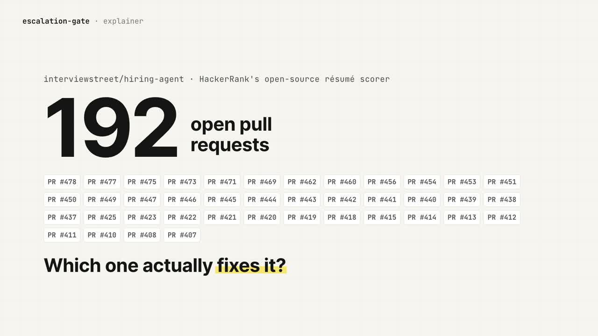

# escalation-gate

**Give it a GitHub issue. It finds the root cause with every code citation checked against the source, then tells you which open pull request fixes it, and whether that PR actually merges.**

[Live demo](https://escalation-gate-rdeepak.vercel.app) · [Videos](https://escalation-gate-rdeepak.vercel.app/#watch) · [Example packet](https://escalation-gate-rdeepak.vercel.app/packets/hiring-agent-424.html) · [Repo board](https://escalation-gate-rdeepak.vercel.app/hiring-agent/) · [Upstream fix it found (PR #480)](https://github.com/interviewstreet/hiring-agent/pull/480)

[](https://escalation-gate-rdeepak.vercel.app/#watch)

## Why

When a bug report lands on a busy repo, a maintainer has three questions: is it real, where exactly is it, and has someone already sent a fix? HackerRank's open-source [hiring-agent](https://github.com/interviewstreet/hiring-agent) had 162 open issues and 192 open PRs. Answering those three questions for one bug took me about 1.5 hours by hand. escalation-gate does it in one command for a few cents, and writes the answer up as one page an engineer can act on in five minutes.

## What it found

On hiring-agent issue **#424** (the same résumé scores differently between runs):

- **Root cause, with 6 of 6 citations verified against the code:** `github.py` labels each repo `project_type`, the project-selection step drops the label, and `transform.py` never prints it, so the rubric scores by a label the grader never sees.
- **192 open PRs → 25** that touch the cited lines (SQL, no model) → **merge #425**, which fixes the cause and merges clean. #415 also fixes it but conflicts. #242, #414 and #462 fix it partly.
- **$0.41 in total** on Sonnet. [The packet](https://escalation-gate-rdeepak.vercel.app/packets/hiring-agent-424.html).

Things it caught that I didn't expect:

1. **A mistake in my own review.** Before building it, I reviewed #424 by hand and said #415 only partly fixes it. The tool said it fully fixes it. I opened the diff, and the tool was right. It also found #242, which I had missed.
2. **A PR that would crash on merge.** On issue #476, it flagged that PR #477 removes a function parameter but leaves one caller still passing it, so merging it raises a `TypeError`. I confirmed it in the diff.
3. **A bug nobody had reported.** `github.py` looks up contributors with the candidate as the repo owner, so team and org repos score as solo projects with zero commits (25 of 99 repos on one public profile). Filed as [#479](https://github.com/interviewstreet/hiring-agent/issues/479), fixed in [PR #480](https://github.com/interviewstreet/hiring-agent/pull/480).

And one thing it got wrong: on that same bug, it claimed GitHub's API never returns org repos. That's false. It was a claim about the outside world, which the packet labels as unchecked reasoning, and that's exactly why the label exists.

## How it works

```
collect      gh → Postgres: open issues, open PRs, every PR's diff
investigate  Claude Code, read-only (Read/Grep/Glob), finds the cause and cites file:line:quote
check        every citation is verified against the code; on failure, one retry in the same session, then a human
shortlist    keep PRs whose diff changes a cited line, or that mention the issue (SQL + diff hunk ranges, no model)
judge        one Claude call, no tools, diffs in the prompt: fixes / partly / no, with one reason each
packet       citations re-checked, git merge-tree per candidate PR, Markdown + HTML written
```

A model is used in two of the six stages. The other four exist to check its output or narrow its work.

### What is proven and what is judgement

| Part of the packet | Status |
|---|---|
| Citations (file, line, quote) | **Checked** against the code, mechanically |
| "Merges clean" / "conflicts" | **Checked** with `git merge-tree` (a dry-run merge; nothing on disk changes) |
| The explanation that links the citations, and the cause-to-symptom chain | Model reasoning, labelled as such |
| Claims about outside systems (e.g. GitHub API behaviour) | Model reasoning, labelled as such |
| PR verdicts (fixes / partly / no) | Judged from the diff, **not run** |
| "No other PR fixes this" | **Never claimed.** A fix in an uncited file, or a PR whose line numbers drifted, is not shortlisted. |

## Run it

Needs: Python 3.11 with [uv](https://docs.astral.sh/uv/), Postgres running locally, the [GitHub CLI](https://cli.github.com/) logged in, and [Claude Code](https://claude.com/claude-code) logged in.

```bash
git clone https://github.com/rdeepak-711/escalation-gate && cd escalation-gate
createdb escalation_gate
uv sync

# the board: every open issue, ⬜ not investigated · ✅ verified · ⚠️ needs a human
uv run python -m gate.cli --repo owner/name --list

# investigate one issue end to end (the board updates)
uv run python -m gate.cli --repo owner/name --issue 123

# no issue number? describe what the user saw
uv run python -m gate.cli --repo owner/name --symptom "what the user saw, in plain words"
```

Each run prints the path of its packet (`out/packet-<id>.html`) and the board (`site/<name>/index.html`).

- The first run on a repo clones it into `vendor/` and collects its open issues and PRs (a few minutes for a busy repo). `--refresh` collects again.
- It uses the Postgres database at `DATABASE_URL` (default `postgresql://localhost/escalation_gate`).
- Cost is about **$0.03–0.45 per issue** on Sonnet. Most of it is the judging step, which is skipped when no open PR touches the cited lines. `--model opus` is stronger and about 5× the cost.
- Each stage can also run alone: `gate.collect`, `gate.investigate`, `gate.candidates`, `gate.packet`.
- Tests need no network and no Claude, but do need the local Postgres: each database test makes its own throwaway database and drops it after (`GATE_TEST_ADMIN_URL`, default `postgresql://localhost/postgres`). Run them with `uv run pytest -q`.

## Use it from Claude Code (MCP)

escalation-gate is also an MCP server, so Claude Code can sweep a repo for you. Register it once, from the cloned folder:

```bash
claude mcp add --scope user escalation-gate -- uv run --directory "$(pwd)" python -m gate.mcp_server
```

Then ask, in any Claude Code session: *"Using escalation-gate, sweep the top 5 issues of owner/name. Tell me which PR solves which issue, which to merge first, and how confident you are."*

It has four tools:

- `start_sweep(repo, top=10, issues=None, model="sonnet")` refreshes the repo's issues and PRs, then investigates the top open issues in the background and returns at once. Issues are ranked by how many open PRs link to them, then by 👍 and comments; feature requests and issues already investigated are skipped, so "top 5" means five new ones. Pass `issues=[...]` to pick them yourself.
- `sweep_status(repo)` shows which issue it's on and the result of each finished one.
- `get_board(repo)` returns every investigated issue with the PR to merge, the other PRs that also fix it (likely duplicates once one is merged), and a confidence level built only from checks that ran: the cause lines were found in the code, the PR's fixing lines are really in its diff, and the PR merges cleanly. Whether those lines fix the bug is still the model's judgement from reading the diff; nothing runs the PR.
- `stop_sweep(repo)` stops after the current issue.

Everything runs on your machine: your Postgres, your `gh` login, and your Claude Code login, so a sweep costs what the issues cost on your own plan (about $0.03–0.45 each on Sonnet). Each issue takes a few minutes. The board is written to `site/<name>/index.html`.

## Limits

- Tested end to end on two unrelated repos: interviewstreet/hiring-agent (an LLM résumé scorer) and interviewstreet/spark-stratifier (a PySpark utility, run cold).
- Runs vary. The same model on the same issue can search more narrowly one time than another, and a narrower search gives a narrower verdict. Borderline PR verdicts can flip between runs.
- One retry. If citations still fail, the run is marked `needs_human` and the packet shows which citation failed.
- The checker proves quotes, not reasoning.

## Docs

- [`docs/mental-model.md`](docs/mental-model.md): the whole system in plain words, stage by stage, with what each does, why, and where it breaks.
- [`docs/flow.md`](docs/flow.md): the execution flow by function.
- [`docs/examples/`](docs/examples/): a full packet as HTML and Markdown.

## Next (V2)

Apply each "fixes" PR to a throwaway copy, run the reproduction before and after, and put the measured result in the packet. That turns "judged from the diff" into "measured".

---

Built by [Deepak R](https://rdeepak.vercel.app) with Claude Code.
